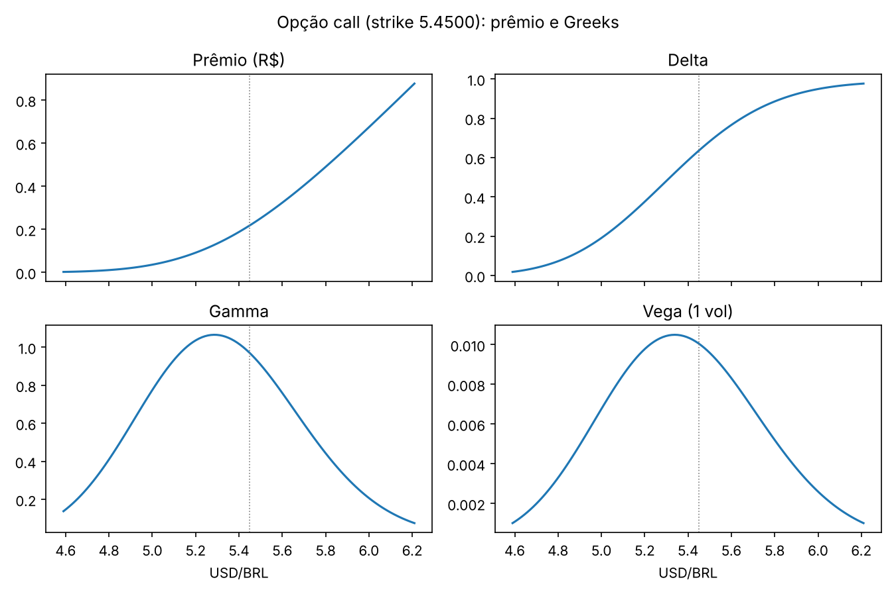
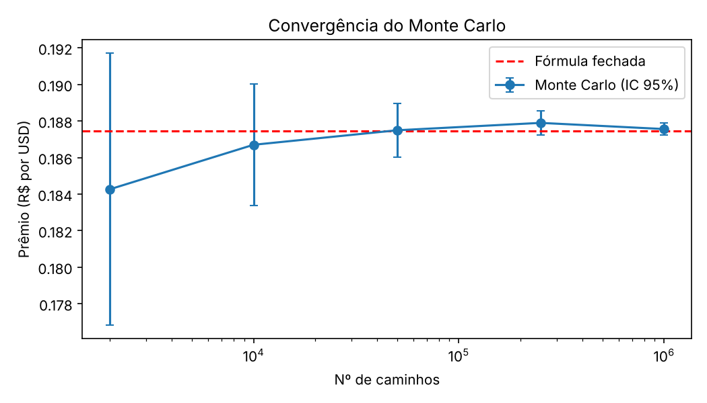
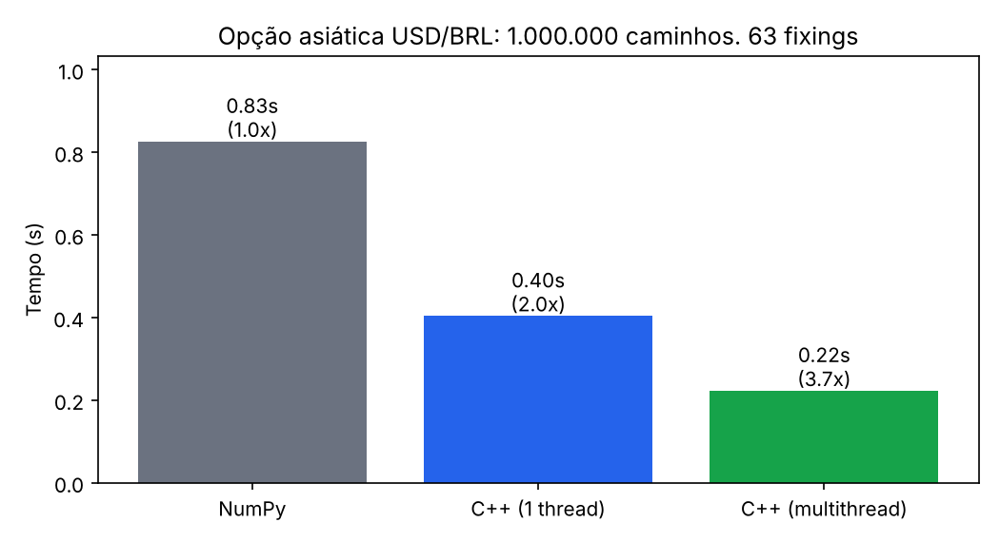

# 🧮 fxpricer

Precificação de **NDF** e **opções de câmbio USD/BRL** em Python: fórmula fechada (Garman-Kohlhagen), Greeks e **Monte Carlo** para produtos que dependem da trajetória (NDF Asiático, opção asiática e NDF com cap).

Projeto de estudo, feito a partir da experiência em mesa de FX e derivativos. Não é recomendação de investimento.



## ✨ O que faz

| Produto | Método | Saída |
|---|---|---|
| NDF vanilla | Paridade coberta de juros | Forward justo, pontos forward, marcação a mercado e payoff |
| Opção europeia (call e put) | Garman-Kohlhagen (forma de Black-76 sobre o forward) | Prêmio, delta, gamma, vega, theta, rho BRL e rho USD |
| NDF Asiático | Monte Carlo | Preço, erro padrão e IC de 95% |
| Opção asiática | Monte Carlo | Preço, erro padrão e IC de 95% |
| NDF com cap | Monte Carlo (premissa simplificada) | Preço, erro padrão e IC de 95% |

Convenções de mercado: BRL com taxa pré efetiva a.a. em base **252 dias úteis**; USD com taxa simples a.a. em base **360 dias corridos**.

## 📁 Estrutura

```
fx-pricer/
├── src/fxpricer/
│   ├── calendario.py   # dias úteis e corridos
│   ├── curves.py       # fatores de desconto, forward e curva pré (flat forward)
│   ├── ndf.py          # NDF vanilla
│   ├── options.py      # opção europeia e Greeks
│   ├── montecarlo.py   # simulação e payoffs dependentes de trajetória
│   ├── nativo.py       # ponte para o núcleo C++ (com fallback)
│   ├── data.py         # PTAX (BCB), SOFR (FRED), curva pré (CSV da B3)
│   └── plots.py        # gráficos
├── cpp/                # núcleo C++17 (fxcore), pybind11, Catch2, benchmark
├── benchmarks/         # NumPy vs C++
├── notebooks/01_precificacao.ipynb
├── tests/
├── docs/               # gráficos usados neste README
└── config.example.yaml
```

## 🚀 Como rodar

```bash
git clone <url-do-seu-repositorio>
cd fx-pricer
python -m venv .venv && source .venv/bin/activate   # no Windows: .venv\Scripts\activate
pip install -e ".[dev]"
pytest                                              # roda os testes
jupyter notebook notebooks/01_precificacao.ipynb
```

## 🧪 Uso rápido

```python
from datetime import date
from fxpricer import NDF, FXOption, dias_uteis, dias_corridos

hoje, venc = date(2026, 11, 25), date(2027, 2, 24)
du, dc = dias_uteis(hoje, venc), dias_corridos(hoje, venc)

ndf = NDF(spot=5.40, strike=5.45, du=du, dc=dc,
          taxa_pre=0.145, taxa_usd=0.043, nocional=1_000_000)
print(ndf.forward(), ndf.valor_presente())

call = FXOption(spot=5.40, strike=5.45, tipo="call", du=du, dc=dc,
                taxa_pre=0.145, taxa_usd=0.043, vol=0.14)
print(call.greeks())
```

## 🌐 Dados de mercado

| Dado | Fonte | Como entra |
|---|---|---|
| PTAX e spot | API Olinda do Banco Central | `fxpricer.data.baixar_ptax` |
| Juros em USD (SOFR) | FRED | `fxpricer.data.baixar_sofr` |
| Curva pré (DI x pré) | Taxas Referenciais da B3 | CSV local com colunas `du` e `taxa` (em % a.a.), lido por `carregar_curva_pre_csv` |
| Volatilidade | Não há fonte gratuita estável para a implícita de USD/BRL | Parâmetro de entrada, ou volatilidade histórica da PTAX como aproximação (`vol_historica`) |

Os valores do notebook são **ilustrativos**. Para usar dados reais, ative `USAR_DADOS_ONLINE` no notebook.

## ✅ Validação

- Paridade put-call: `C - P = DF_brl * (F - K)`.
- Greeks analíticos conferidos contra diferenças finitas (delta, gamma e vega).
- Monte Carlo da opção europeia confere com a fórmula fechada dentro de 4 erros padrão.
- Valor esperado do NDF Asiático conferido contra a expressão analítica no modelo.



## ⚡ Núcleo em C++

O Monte Carlo e a fórmula fechada também existem em **C++17** (`cpp/`), expostos ao Python via **pybind11**.

- Fórmula fechada, Greeks e 4 payoffs (europeia, asiática, NDF asiático, NDF com cap).
- Monte Carlo **multithread** com xoshiro256++, Box-Muller em lote e variáveis antitéticas.
- **Determinístico**: mesma semente, mesmo resultado, com qualquer número de threads (cada bloco de caminhos tem seu próprio gerador).
- Testes em C++ (Catch2) que conferem os valores com a versão Python, mais testes em `tests/test_cpp.py`.

```bash
cmake -S cpp -B build -G Ninja && cmake --build build   # gera src/fxpricer/_fxcore*.so
ctest --test-dir build                                  # testes C++
python benchmarks/benchmark_mc.py                       # NumPy vs C++
```

```python
import fxpricer as fx
fx.CPP_DISPONIVEL                      # True se o módulo foi compilado
fx.preco_mc_cpp("asian_option", strike, spot, forward_T, vol, tempos, df, n_caminhos=1_000_000)
```

Sem compilar, o pacote continua funcionando só com Python.



Opção asiática, 1 milhão de caminhos, 63 fixings, máquina de 2 núcleos: C++ ficou cerca de **2x** mais rápido que NumPy em 1 thread e **3,7x** com 2 threads. O ganho cresce com mais núcleos.

## ⚠️ Limitações

- Volatilidade constante: não há smile nem superfície de volatilidade, e USD/BRL tem smile relevante.
- Calendário simplificado (sábado, domingo e os feriados informados pelo usuário).
- NDF com cap segue premissa simplificada (ganho limitado acima do cap); contratos reais variam.
- Preço teórico sem bid/offer, crédito (CVA) ou custos de funding.

## 🗺️ Próximos passos

- Superfície de volatilidade (delta pillars: ATM, risk reversal e butterfly).
- Calendário ANBIMA completo.
- Interface em Streamlit.
- Gregas do Monte Carlo (pathwise e likelihood ratio) no núcleo C++.
- Calibração a dados de mercado e análise de cenários.

## 📄 Licença

MIT. Veja `LICENSE`.
